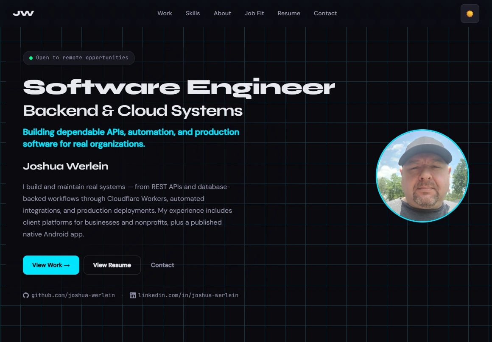

<div align="center">

# 💻 Joshua Werlein · Software Engineering Portfolio

### Backend & Cloud Systems · Production APIs · Automation

[](https://joshuawerlein.com)
[](https://react.dev/)
[](https://vite.dev/)
[](https://www.cloudflare.com/)

**[Live site](https://joshuawerlein.com)** · **[GitHub](https://github.com/joshua-werlein/portfolio)** · **[Resume](https://joshuawerlein.com/resume)** · **[LinkedIn](https://www.linkedin.com/in/joshua-werlein)**

</div>

## ✨ Overview

A React portfolio for five client platforms and one published Android app. The site includes expandable case studies, a browser-readable resume, a Job Fit Checker, and a contact workflow.

[](docs/screenshots/portfolio-home.webp)

## 🚀 Project showcase

| Featured case study | Live | Source |
| :--- | :--- | :--- |
| Grayz'n Buffalo Bar & Grill | [Restaurant site](https://grayznbuffalo.com) | [GitHub](https://github.com/joshua-werlein/grayzn-buffalo) |
| Friends of Lake Henry | [Nonprofit site](https://friendsoflakehenry.com) | [GitHub](https://github.com/joshua-werlein/friends-of-lake-henry) |
| KIL Construction | [Construction site](https://kilcon.work) | [GitHub](https://github.com/joshua-werlein/kilConstruction) |

| More work | Live | Source |
| :--- | :--- | :--- |
| Best By Manager | [Google Play](https://play.google.com/store/apps/details?id=com.bestbymanager.app) | [GitHub](https://github.com/joshua-werlein/BestByManager) |
| Arkham Enterprises | [Solar and construction site](https://www.arkhamsolar.com) | [GitHub](https://github.com/joshua-werlein/arkham-solar) |
| Blair Sportsmen's Club | [Club site](https://blairsportsmensclub.com) | |

## 🧩 Architecture

| Layer | Responsibility |
| :--- | :--- |
| [React and Vite](vite.config.js) | Builds the portfolio and standalone HTML resume as separate entry points. The public PDF and [llms.txt](public/llms.txt) ship as static assets. |
| [Cloudflare API Worker](portfolio-worker.js) | Handles Job Fit, contact submissions, event tracking, and protected administration. |
| D1 and KV | D1 stores contact leads, statuses, and notes. KV stores site, resume, and project interaction counters. |

<details>
<summary><strong>Job Fit, contact, and analytics flows</strong></summary>

- **Job Fit** — The Worker verifies Turnstile and applies a rate limit before sending the job description and candidate profile to Groq. The frontend displays a structured assessment.
- **Contact** — The Worker validates messages, stores leads in D1, and uses Resend for email delivery. The admin panel supports reviewing leads, updating status, and adding notes.
- **Analytics** — The frontend sends portfolio, resume, and project events. The Worker maintains aggregate counters in KV and exposes them through the authenticated admin panel.

</details>

## 💻 Local development

```bash
npm ci
npm run dev
npm run lint
npm run build
```

Vite writes the static site to `dist/`. The API base URL is defined in [App.jsx](src/App.jsx). Use mock or development bindings when testing data writes and email. The API Worker has a separate [Wrangler configuration](wrangler.jsonc) and release from the static portfolio.
